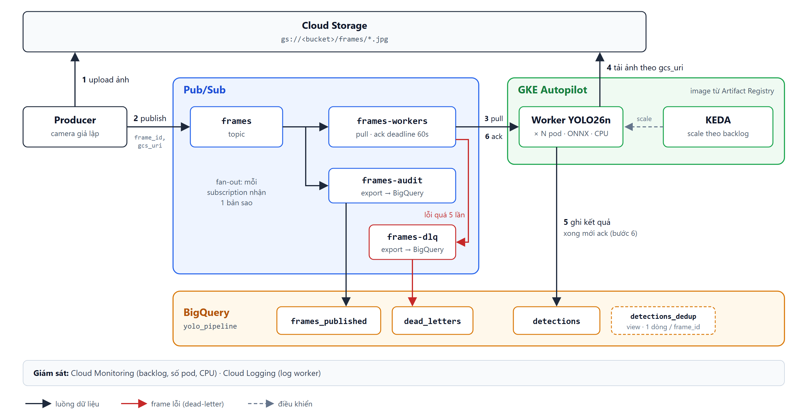

# PLAN — Autoscaled YOLO Stream Pipeline (YOLO26) trên Google Cloud

> Nhóm **Cloudy With a Chance of A** · Cloud Computing · HCMUT · HK1 2026-2027
> Mini-project (40%) · Hạn nộp cuối: **12/12/2026** (slide, báo cáo, source code, link video)
> Seminar Pub/Sub (30%) đã có slide, trình bày tuần 12-14.

Tài liệu này là kế hoạch từ đầu đến cuối, **chưa có code**. Công việc chia theo nhóm (mục 3), mỗi việc ghi rõ: làm gì, ra sản phẩm gì, và lấy bằng chứng gì cho báo cáo.

---

## 0. Hai quyết định nền tảng

### 0.1. Model: YOLO26n (Ultralytics), chạy ONNX trên CPU

- **NMS-free (end-to-end):** output đã là danh sách box cuối, worker chỉ cần lọc theo confidence.
- Thiết kế cho edge / **CPU**, không cần GPU.

Hệ quả: image worker chỉ cần `onnxruntime` + `numpy` + `opencv`, **không cài `ultralytics` trong image chạy**. Image nhỏ nên pod mới kéo image và khởi động nhanh hơn, giảm cold start (một "challenge" đã nêu trong đề xuất).

- Export 1 lần trên máy: `YOLO("yolo26n.pt").export(format="onnx")` → `yolo26n.onnx`.
- ⚠️ Kiểm tra ở việc B1: shape output thực tế (dự kiến `[1, 300, 6]` = `x1, y1, x2, y2, conf, class_id`), xem bằng Netron hoặc `session.get_outputs()`.

### 0.2. Hệ thống chạy trên GCP, nộp bài bằng video + GitHub

Giảng viên không cần vào project GCP. **Video demo là bằng chứng chính** cho thấy hệ thống chạy thật trên cloud. Repo GitHub bổ sung phần code và số liệu:

1. **Video demo** quay toàn bộ quá trình chạy trên GCP (kịch bản ở mục 7).
2. **Hạ tầng dưới dạng script** (`infra/`): đọc script là biết hệ thống gồm gì, dựng bằng 1 lệnh và xoá bằng 1 lệnh.
3. **Số liệu xuất ra file trong repo** (`reports/results/*.csv`): mọi biểu đồ trong báo cáo truy ngược được về dữ liệu gốc.
4. **Dashboard lưu dạng JSON trong repo** (`monitoring/`) và có ảnh chụp kèm.
5. **Cấu hình mỗi lần chạy** (`reports/results/<lần chạy>/run.json`): kịch bản, lịch gửi, thời gian, image.

---

## 1. Kiến trúc



File gốc: [docs/architecture.svg](docs/architecture.svg) (sửa được, dùng cho báo cáo), [docs/architecture.png](docs/architecture.png) (dán vào slide).

Luồng 1 frame (số trên sơ đồ):
1. **Upload:** Producer cắt video thành frame, upload JPEG lên Cloud Storage.
2. **Publish:** Producer gửi message nhỏ `{frame_id, gcs_uri, camera_id, published_at}` vào topic `frames` (gửi đường dẫn, không gửi ảnh, vì giới hạn 10 MB/message). Pub/Sub **fan-out** sang 2 subscription:
   - `frames-workers` (pull): cho worker xử lý.
   - `frames-audit` (BigQuery export): tự ghi mọi frame đã publish vào bảng `frames_published`, **không cần viết code**.
3. **Pull:** Worker kéo message từ `frames-workers`.
4. **Tải ảnh:** Worker tải ảnh từ Cloud Storage theo `gcs_uri`, chạy YOLO26n.
5. **Ghi kết quả** vào bảng `detections`.
6. **Ack:** chỉ ack sau khi bước 5 thành công. Lỗi → NACK → giao lại → quá 5 lần → `frames-dlq` → `dlq-audit` tự ghi vào `dead_letters`.

Song song: KEDA đọc backlog của `frames-workers` (qua Cloud Monitoring) để tăng/giảm số pod worker; image worker lấy từ Artifact Registry.

Điểm hay khi báo cáo: kiến trúc **dùng cả 3 kiểu subscription và fan-out đã trình bày ở seminar** (pull cho worker, export cho kiểm toán, dead-letter cho frame lỗi). Seminar và project nối thẳng vào nhau.

**Kiểm chứng "không mất, không trùng" bằng SQL trên BigQuery:**
- Mất frame = `frames_published` − `detections` (theo frame_id) − `dead_letters`, phải = 0.
- Giao trùng: đếm số dòng thô có `frame_id` lặp trong `detections` (chứng minh at-least-once có xảy ra thật), còn view `detections_dedup` (lấy 1 bản ghi mỗi `frame_id` bằng `QUALIFY ROW_NUMBER()`) phải không có trùng.
- Mỗi frame là 1 dòng trong `detections` (các object nằm trong cột lặp `objects`, frame không có object vẫn có dòng). Worker insert với `insertId = frame_id` để BigQuery tự loại trùng gần nhau; view dedup xử lý phần còn lại. Không dùng `MERGE` mỗi frame vì DML của BigQuery có giới hạn số câu chạy đồng thời.

---

## 2. Cấu trúc repo GitHub

```
Cloud-computing/
├── README.md, PLAN.md
├── .env.example                 # cấu hình chung (copy thành .env)
├── requirements.txt             # cho máy cá nhân: producer, tools, test
├── requirements-worker.txt      # cho image worker
├── Dockerfile                   # image worker
├── src/
│   ├── common.py                # schema message, log JSON, đọc .env
│   ├── detector.py              # YOLO26n trên ONNX Runtime: letterbox, map box về ảnh gốc
│   ├── worker.py                # pull → tải ảnh → detect → ghi BigQuery → ack; /healthz
│   └── producer.py              # camera giả lập: --schedule, --corrupt-rate
├── models/export_yolo26.py      # yolo26n.pt → yolo26n.onnx, in shape output và ms/frame
├── infra/
│   ├── lib.sh                   # đọc .env, hàm dùng chung
│   ├── setup.sh                 # bucket, Pub/Sub, BigQuery, Artifact Registry, service account, dashboard
│   ├── cluster.sh               # build | up | keda | fixed N | down
│   └── bigquery/                # schema bảng, view, verify.sql
├── k8s/
│   ├── worker.yaml              # namespace, service account (Workload Identity), Deployment
│   └── keda.yaml                # TriggerAuthentication + ScaledObject (scaler gcp-pubsub)
├── monitoring/dashboard.json
├── tests/test_worker.py         # ack/nack, toạ độ box, lịch gửi
├── tools/
│   ├── run_scenario.py          # chạy 1 kịch bản, ghi run.json + pods.csv
│   ├── collect.py               # BigQuery + Monitoring → CSV, biểu đồ, stats.json; --compare
│   └── draw_boxes.py            # ảnh có bounding box cho slide
├── reports/results/             # mỗi lần chạy 1 thư mục
├── reports/figures/             # biểu đồ tổng hợp, ảnh chụp
└── docs/
    ├── HUONG-DAN.md             # các bước chạy trên Google Cloud
    └── architecture.svg / .png
```

---

## 3. Danh sách công việc

Công việc chia thành 10 nhóm, mỗi việc có mã (A1, B2...) để theo dõi và tạo issue trên GitHub. Làm theo thứ tự nhóm; trong một nhóm, các việc không phụ thuộc nhau có thể làm song song.

```
A Chuẩn bị ─► B Kiểm tra rủi ro ─► C Hạ tầng ─┬─► F Chạy end-to-end ─► G Autoscale ─► I Kiểm thử ─► J Nộp bài
                                    D Producer ┤                      H Giám sát ──┘
                                    E Worker ──┘
```

D, E làm song song với C. H làm song song với G. Báo cáo (J) viết dần từ khi xong C, không đợi đến cuối.

### A. Chuẩn bị môi trường

- [ ] **A1. Project GCP:** kiểm tra credit 300 USD; chọn region `us-central1` (giá trong đề xuất tính theo region này) hoặc `asia-southeast1` (gần hơn, kiểm tra lại giá).
- [ ] **A2. Budget alert** 30 USD, ngưỡng 33 / 66 / 100% (tạo tay: Billing → Budgets & alerts).
- [ ] **A3. Cài công cụ** trên máy: `gcloud` CLI + `gke-gcloud-auth-plugin`, `kubectl`, `helm`, Docker Desktop, Python 3.11, Git.
- [ ] **A4. Repo GitHub:** tạo theo cấu trúc mục 2, bảo vệ nhánh `main`, làm việc qua Pull Request. Thêm key JSON vào `.gitignore`, **không bao giờ commit key**.
- [ ] **A5. GitHub Projects** (Kanban): tạo 1 issue cho mỗi việc trong mục này. Chụp ảnh bảng để đưa vào phần "Quản lý dự án" của báo cáo.
- [ ] **A6. Video nguồn:** chọn video giao thông/đường phố miễn phí (Pexels/Pixabay), ghi nguồn và license trong README.
- [ ] **A7. Quy tắc chi phí:** xong buổi thử nào thì chạy `bash infra/cluster.sh down` buổi đó, ghi lại chi phí.

### B. Kiểm tra rủi ro sớm

Mỗi việc là một thử nghiệm nhỏ. Kết quả ghi thẳng vào báo cáo.

- [ ] **B1. YOLO26 → ONNX:** export `yolo26n.onnx`, chạy 1 ảnh bằng onnxruntime, kiểm tra shape output (dự kiến `[1, 300, 6]`), đo ms/frame trên CPU.
- [ ] **B2. Pub/Sub:** tạo topic + subscription pull có dead-letter (max 5) + 1 subscription BigQuery export; NACK liên tục, xem message có sang DLQ không. Cấp quyền Publisher/Subscriber cho service account của Pub/Sub.
- [ ] **B3. KEDA trên GKE Autopilot** (rủi ro lớn nhất, làm đầu tiên trong nhóm B): tạo cluster nhỏ, cài KEDA bằng helm, cấu hình Workload Identity cho KEDA đọc Cloud Monitoring, tạo thử 1 ScaledObject `gcp-pubsub`. Thử xong xoá cluster ngay.
- [ ] **B4. BigQuery:** insert thử với `insertId`, tạo và chạy view dedup.

Xong nhóm B khi: cả 4 thử nghiệm chạy được, hoặc đã chọn xong phương án dự phòng (mục 9).

### C. Hạ tầng GCP (`infra/`)

- [ ] **C1. `setup.sh`:** bật API; tạo bucket (lifecycle xoá ảnh sau 7 ngày), topic `frames` + `frames-dlq`, 3 subscription (`frames-workers` pull + dead-letter, `frames-audit` và `dlq-audit` export BigQuery), Artifact Registry, service account + IAM, dashboard.
- [ ] **C2. BigQuery** (`infra/bigquery/`): dataset `yolo_pipeline`;
  - `detections(frame_id, camera_id, gcs_uri, num_objects, objects[class_id, class_name, conf, x1, y1, x2, y2], worker_pod, delivery_attempt, download_ms, infer_ms, published_at, processed_at)`, 1 dòng mỗi frame, partition theo ngày `processed_at`;
  - `frames_published`, `dead_letters` theo schema của BigQuery subscription (data + message_id, publish_time, attributes);
  - view `detections_dedup`.
- [ ] **C3. `cluster.sh`:** `build` (image), `up` (GKE Autopilot + Workload Identity + KEDA), `keda` / `fixed N` (chế độ scale), `down` (xoá cluster, bắt buộc sau mỗi buổi).

### D. Producer (`src/producer.py`)

- [ ] **D1.** Đọc video bằng OpenCV, resize 640, encode JPEG, upload lên Cloud Storage.
- [ ] **D2.** Publish message `{frame_id, gcs_uri, camera_id, published_at}`. `frame_id = {camera_id}-{run_id}-{số thứ tự}` (lọc được số liệu theo lần chạy).
- [ ] **D3.** Tham số: `--schedule 60:2,120:20` (giây:frame/s), `--corrupt-rate` (gửi ảnh hỏng cho kịch bản frame lỗi).
- [ ] **D4.** Chạy được trên máy cá nhân và trên Cloud Shell / VM nhỏ (upload từ trong GCP nhanh và ổn định hơn).

### E. Worker (`src/worker.py`, `src/detector.py`, `Dockerfile`)

- [ ] **E1.** Load ONNX **một lần** lúc khởi động; `/healthz` chỉ OK sau khi load xong (dùng làm readinessProbe, đo được cold start).
- [ ] **E2.** Streaming pull, flow control `max_messages` = 1 / pod; ack deadline 60s.
- [ ] **E3.** Tải ảnh theo `gcs_uri`, chạy YOLO26n, lọc theo confidence.
- [ ] **E4.** Insert BigQuery với `insertId = frame_id`; thành công mới ACK, exception thì NACK.
- [ ] **E5.** Log JSON (frame_id, pod, infer_ms, delivery_attempt) ra stdout để Cloud Logging tự gom.
- [ ] **E6.** Dockerfile nhẹ (chỉ `onnxruntime`, `numpy`, `opencv-python-headless`, thư viện Google Cloud); build và push lên Artifact Registry.
- [ ] **E7.** Unit test (`tests/test_worker.py`): logic ack/nack, toạ độ box.

### F. Chạy pipeline end-to-end

Cần xong trước: C, D, E.

- [ ] **F1.** `k8s/worker.yaml`: `requests` 1 vCPU / 2 GiB, readinessProbe.
- [ ] **F2.** Chạy producer 1 phút → kiểm tra bằng SQL: mất frame = 0.
- [ ] **F3.** `tools/draw_boxes.py`: vẽ bounding box lên ảnh từ kết quả trong BigQuery (dùng cho slide).

Bằng chứng: ảnh console Pub/Sub, kết quả SQL trên BigQuery, ảnh frame có bounding box.

### G. Autoscale với KEDA (`k8s/`)

Cần xong trước: F.

- [ ] **G1.** `k8s/keda.yaml`: `TriggerAuthentication` dùng Workload Identity.
- [ ] **G2.** Cùng file: ScaledObject scaler `gcp-pubsub`, `subscriptionName: frames-workers`, `mode: SubscriptionSize`, `value: "10"`, `minReplicaCount: 1`, `maxReplicaCount: 8`, `pollingInterval: 10`, scale down sau 60 s.
- [ ] **G3.** Thử `minReplicaCount: 0` để minh hoạ scale-to-zero và cold start.
- [ ] **G4.** Kiểm tra: tăng tốc độ gửi → pod tăng, dừng producer → pod giảm.

Lưu ý: số liệu Pub/Sub trên Cloud Monitoring trễ khoảng 1–2 phút, nên KEDA phản ứng chậm hơn tải thật; ghi nhận và đưa vào báo cáo.
Bằng chứng: clip màn hình `kubectl get pods -w` song song với dashboard.

### H. Giám sát (`monitoring/`)

- [ ] **H1. Dashboard Cloud Monitoring** (`dashboard.json`, tạo bởi `setup.sh`): backlog và tuổi message cũ nhất của `frames-workers`; số pod worker; tốc độ publish/ack; CPU worker; số message vào dead-letter.
- [ ] **H2. Log** của worker xem ở Logs Explorer (`jsonPayload.message="frame done"`).

### I. Kiểm thử và thu số liệu (`tools/`, `reports/`)

Cần xong trước: G, H.

- [ ] **I1. Đo năng lực 1 pod** (frame/s tối đa, ký hiệu `C`) bằng kịch bản `capacity`. Mọi mức tải bên dưới tính theo `C`.
- [ ] **I2. Thu số liệu:** `tools/run_scenario.py` chạy kịch bản và ghi số pod; `tools/collect.py` kéo SQL kiểm chứng từ BigQuery + backlog từ Cloud Monitoring → CSV.
- [ ] **I3. Chạy 5 kịch bản:**

  | # | Kịch bản | Cách làm | Số liệu ghi lại | Mong đợi |
  |---|---|---|---|---|
  | 1 | Tải đều | 0.5·C trong 3 phút, rồi 3·C trong 5 phút | backlog, số pod, throughput, latency p95 | Mọi frame có kết quả, pod tăng khi tải cao |
  | 2 | Tải đột biến | 0.5·C → 5·C đột ngột | **thời gian từ lúc tăng tải → pod mới xử lý frame đầu tiên**, tách: KEDA phản ứng / Autopilot cấp node + schedule pod / load model | Backlog phình rồi giảm |
  | 3 | Lúc rảnh | Dừng producer | thời gian về `minReplicaCount` | Pod giảm về tối thiểu |
  | 4 | Worker chết | `kubectl delete pod` ngẫu nhiên mỗi 30s khi tải cao | số lần giao lại, mất, trùng (thô / sau dedup) | **0 mất, 0 trùng sau dedup** |
  | 5 | Frame lỗi | `--corrupt-rate 0.02` | số dòng `dead_letters`, backlog có kẹt không | Frame lỗi vào DLQ, hàng đợi vẫn chạy |

- [ ] **I4. So sánh cố định vs KEDA** (luận điểm chính của báo cáo): chạy kịch bản 2 với cố định 1 pod, cố định 8 pod và KEDA → biểu đồ latency và "pod·giờ" quy ra USD. Kỳ vọng: KEDA cho latency gần bằng 8 pod cố định nhưng tốn ít tiền hơn nhiều.
- [ ] **I5. Quay video demo** ngay trong buổi chạy kiểm thử (kịch bản ở mục 7) để khỏi phải dựng lại cluster.
- [ ] **I6. Biểu đồ:** `tools/collect.py` vẽ cho từng lần chạy; `--compare` vẽ biểu đồ so sánh.

Quy tắc đo:
- Gom các kịch bản vào ít buổi chạy (mỗi buổi 2–3 giờ), xoá cluster sau mỗi buổi.
- Mỗi kịch bản chạy 2–3 lần nếu ngân sách cho phép, báo cáo trung bình.
- Cấu hình mỗi lần chạy tự lưu trong `run.json`.
- **Chạy I2 trước khi xoá cluster.**
- Ghi riêng cold start với throughput khi đã ổn định.

### J. Báo cáo, slide, video, nộp bài

- [ ] **J1.** Viết báo cáo theo mục 5 (viết dần, mỗi nhóm việc xong thì viết phần tương ứng).
- [ ] **J2.** Làm slide theo mục 6.
- [ ] **J3.** Dựng video từ phần quay ở I5, upload YouTube (unlisted) hoặc Google Drive.
- [ ] **J4.** README hoàn chỉnh: ảnh kiến trúc, link video, bảng kết quả.
- [ ] **J5.** Kiểm tra lần cuối: quét repo không có key/secret (gitleaks), cluster đã xoá, đối chiếu tổng chi phí trên Billing, tag release `v1.0`.
- [ ] **J6.** Nộp: slide, báo cáo, link repo, link video.

---

## 4. Chi phí và kiểm soát

| Khoản | Ước tính (us-central1, kiểm tra lại bảng giá khi làm) |
|---|---|
| GKE Autopilot | Phí cluster được bù bởi credit 74,40 USD/tháng; pod ~0,054 USD/giờ (1 vCPU + 2 GiB) |
| Pub/Sub | Miễn phí 10 GiB/tháng, message nhỏ nên gần như 0 |
| Cloud Storage | Vài GB ảnh, < 1 USD; đặt lifecycle xoá ảnh sau 7 ngày |
| BigQuery | Lưu trữ và truy vấn nhỏ, nằm trong mức miễn phí |
| Tổng | ~8 pod × 10 giờ thử ≈ 4–5 USD, **dưới 10 USD** nếu xoá cluster sau mỗi buổi |

Cách làm: budget alert, `maxReplicaCount` giới hạn, `cluster.sh down` sau mỗi buổi, ghi chi phí từng buổi. Bảng chi phí thực tế (ảnh Billing report) đưa vào báo cáo.

---

## 5. Cấu trúc báo cáo cuối

1. **Giới thiệu**: bài toán xử lý luồng ảnh, mục tiêu, phạm vi (không train model, CPU only).
2. **Cơ sở lý thuyết**: message queue, Pub/Sub (tóm tắt từ seminar), Kubernetes/HPA, GKE Autopilot, KEDA, YOLO26.
3. **Thiết kế hệ thống**: sơ đồ kiến trúc, luồng 1 frame, schema message và bảng BigQuery, bảng 7 vấn đề → giải pháp.
4. **Hiện thực**: producer, worker (ack sau khi ghi, idempotent), 3 kiểu subscription, autoscale, monitoring, IAM/Workload Identity.
5. **Kiểm thử & đánh giá**: 5 kịch bản, bảng số liệu, biểu đồ, so sánh cố định vs KEDA.
6. **Chi phí**: chi phí thực tế từng buổi, ước tính khi chạy thật 24/7.
7. **Thảo luận**: hạn chế (độ trễ metric, cold start, CPU-only), hướng phát triển (Cloud Run + push subscription, GPU, Terraform).
8. **Kết luận**, tài liệu tham khảo, phụ lục (hướng dẫn dựng lại bằng `infra/setup.sh`, link repo, video, dashboard).

---

## 6. Slide trình bày project cuối (~15 slide, ~15 phút)

Dùng lại template và màu của slide seminar cho thống nhất. Mỗi slide 1 thông điệp, nhiều hình ít chữ.

| # | Slide | Nội dung chính | Hình |
|---|---|---|---|
| 1 | Tiêu đề | Autoscaled YOLO26 Stream Pipeline on Google Cloud · tên nhóm | logo |
| 2 | Bài toán | Nhiều camera, tải lúc cao lúc thấp → nghẽn hoặc lãng phí | biểu đồ tải theo giờ |
| 3 | 7 vấn đề → giải pháp | Bảng vấn đề ↔ thành phần GCP | 2 cột + mũi tên |
| 4 | Kiến trúc | Producer → GCS → Pub/Sub → GKE worker → BigQuery, KEDA, DLQ | sơ đồ lớn có icon GCP |
| 5 | Vòng đời 1 frame | Nhấn "ACK sau khi ghi" | sequence diagram |
| 6 | Pub/Sub trong project | 3 kiểu subscription + fan-out (nối với seminar) | sơ đồ topic → 3 sub |
| 7 | Worker & YOLO26 | ONNX, NMS-free, CPU, idempotent | ảnh frame có bbox |
| 8 | Autoscale với KEDA | Backlog → KEDA → HPA → pod, Workload Identity | sơ đồ + đoạn YAML ngắn |
| 9 | Monitoring | Dashboard Cloud Monitoring | ảnh chụp dashboard |
| 10 | Hạ tầng dưới dạng script | `setup.sh`, `cluster.sh build / up / down` | sơ đồ các bước dựng / xoá |
| 11 | Kết quả: tải đều & đột biến | Backlog + số pod theo thời gian, thời gian phản ứng | biểu đồ |
| 12 | Kết quả: độ tin cậy | Worker chết & frame lỗi: 0 mất, trùng được loại, DLQ | bảng số |
| 13 | Cố định vs KEDA + chi phí | Latency & USD | biểu đồ cột |
| 14 | Hạn chế & hướng phát triển | Độ trễ metric, cold start, Cloud Run | gạch đầu dòng |
| 15 | Kết luận + link | Repo GitHub (QR), video, dashboard | QR code |

Slide 9–13 dùng ảnh và biểu đồ thật từ `reports/figures/`.

---

## 7. Kịch bản video demo (~6–8 phút)

Quay màn hình chia đôi: **trái** terminal (`kubectl get pods -w`), **phải** Cloud Monitoring dashboard. Quay trong buổi chạy kiểm thử (việc I5).

1. (30s) Giới thiệu kiến trúc bằng slide 4.
2. (1 phút) Lướt qua console GCP: bucket, topic + 3 subscription, BigQuery dataset, cluster Autopilot, image trong Artifact Registry.
3. (1,5 phút) Tải đều → tải đột biến: backlog tăng, pod tăng, backlog giảm.
4. (1 phút) Xoá pod giữa chừng → message giao lại → SQL kiểm chứng: 0 mất.
5. (1 phút) Gửi frame lỗi → xem `dead_letters` trong BigQuery.
6. (1 phút) Dừng producer → pod giảm về tối thiểu.
7. (30s) Ảnh frame có bounding box.
8. (30s) Chạy `bash infra/cluster.sh down`, kết luận.

Mẹo: tua nhanh đoạn chờ (ghi "x4" trên video), phụ đề ngắn mỗi bước. Upload YouTube (unlisted) hoặc Google Drive, dán link vào README và báo cáo.

---

## 8. Rủi ro & phương án dự phòng

| Rủi ro | Dự phòng |
|---|---|
| KEDA không chạy được trên Autopilot | HPA + Custom Metrics Stackdriver Adapter theo Pub/Sub, hoặc HPA theo CPU |
| Chi phí vượt dự kiến | Budget alert, `maxReplicaCount`, xoá cluster sau mỗi buổi, gom kịch bản vào ít buổi |
| Hết credit / tài khoản không nhận credit | Dùng tài khoản Google khác; giảm số lần lặp kịch bản |
| Metric Pub/Sub trễ 1–2 phút làm KEDA phản ứng chậm | Ghi nhận và đo thực tế, đưa vào phần thảo luận |
| Cold start (Autopilot cấp node + pull image + load model) | Image nhỏ, `minReplicaCount ≥ 1`, đo tách riêng từng thành phần |
| Output ONNX của YOLO26 khác dự kiến | Kiểm tra ở việc B1; nếu cần tạm dùng YOLO11n |
| Lộ key/secret lên GitHub | `.gitignore`, quét gitleaks trước khi nộp |
| Số liệu dao động | Lặp kịch bản, ghi cấu hình từng lần chạy |
