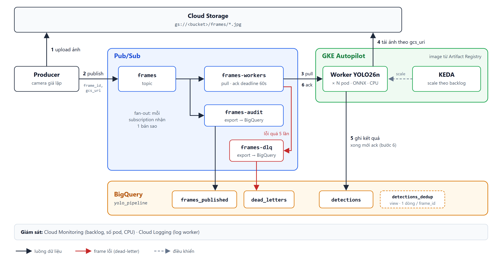

# Autoscaled YOLO26 Stream Pipeline on Google Cloud

Nhóm **Cloudy With a Chance of A** · Cloud Computing · HCMUT

Camera giả lập gửi frame lên Cloud Storage, Pub/Sub phân phối cho các worker YOLO26n trên GKE Autopilot, kết quả ghi vào BigQuery, KEDA tăng giảm số worker theo số message đang chờ.



- Video demo: _(thêm link)_
- Kế hoạch: [PLAN.md](PLAN.md) · Hướng dẫn chạy: [docs/HUONG-DAN.md](docs/HUONG-DAN.md)

## Cách hoạt động

1. `src/producer.py` đọc video, upload từng frame lên Cloud Storage, publish message nhỏ `{frame_id, gcs_uri, camera_id, published_at}` vào topic `frames`.
2. Pub/Sub chia cho 2 subscription: `frames-workers` (pull, cho worker) và `frames-audit` (ghi thẳng vào BigQuery để đối soát).
3. `src/worker.py` kéo message, tải ảnh, chạy YOLO26n (`src/detector.py`, ONNX trên CPU), ghi 1 dòng vào `detections`, **rồi mới ack**. Lỗi thì nack; quá 5 lần message sang `frames-dlq` và được ghi vào `dead_letters`.
4. KEDA (`k8s/keda.yaml`) đặt số pod = ceil(backlog / 10), từ 1 đến 8.
5. Kiểm chứng bằng SQL (`infra/bigquery/verify.sql`): mọi frame đã publish đều có trong `detections` hoặc `dead_letters`.

## Cấu trúc

| Đường dẫn | Nội dung |
|---|---|
| `src/` | `common.py` (message, log), `detector.py` (YOLO26n), `worker.py`, `producer.py` |
| `Dockerfile`, `requirements-worker.txt` | image worker |
| `models/export_yolo26.py` | export model sang ONNX |
| `infra/` | `setup.sh` (hạ tầng), `cluster.sh` (image, cluster, chế độ scale), schema BigQuery |
| `k8s/` | `worker.yaml` (Deployment), `keda.yaml` (autoscale) |
| `monitoring/dashboard.json` | dashboard Cloud Monitoring |
| `tools/` | `run_scenario.py` (chạy kịch bản), `collect.py` (số liệu + biểu đồ), `draw_boxes.py` |
| `tests/test_worker.py` | unit test, không cần GCP: `python -m pytest` |
| `reports/results/` | số liệu từng lần chạy |

## Chạy nhanh

```bash
cp .env.example .env                        # đặt PROJECT_ID
pip install -r requirements.txt
python models/export_yolo26.py data/sample.jpg
bash infra/setup.sh
bash infra/cluster.sh build && bash infra/cluster.sh up
python tools/run_scenario.py smoke --video data/traffic.mp4
bash infra/cluster.sh down
```
Chi tiết từng bước và cách xử lý lỗi: [docs/HUONG-DAN.md](docs/HUONG-DAN.md).

## Kết quả

_(Điền sau khi chạy kiểm thử: bảng `summary.csv` của 5 kịch bản, `reports/figures/compare_burst.png`.)_

## Nguồn

- Video thử nghiệm: _(link + license)_
- YOLO26: Ultralytics, https://docs.ultralytics.com
